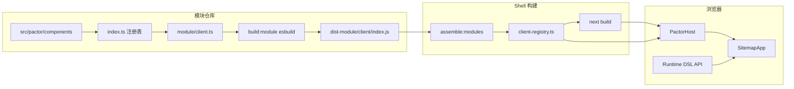

# InnoSpots Web Shell（`innospots-web-shell`）

基于 **Next.js App Router + Pactor** 的统一 Web 入口：在**构建期**装配多个 UI npm 模块（YAML DSL、扩展组件、静态资源），在**运行期**通过统一 DSL API 与 `PactorHost` 渲染业务页面。

> 整体架构与术语见 InnoSpots 前端模块化设计（Build-time Composition + Runtime DSL Loading）。UI 模块侧打包见仓库 `innospots-nexus-ui-console` 的 `npm run build:module`。

**当前接入**：`pactor-apps` 下两个 tgz 模块 `risk-analysis@0.1.2` / `risk-decision@0.1.2`。风险分析的业务 API 已随 tgz 的 `server/index.mjs` 分发，由 Shell 的 `/api/modules/<moduleId>/*` 统一承接。左侧固定菜单定义在 `src/shell/sitemap.yaml`，模块启停与菜单接入模式在 `src/modules/module-list.json`。

---

## 设计目标

本工程（Web Shell）与配套 UI npm 模块共同服务于 **多业务前端合一部署**，在保留 Pactor YAML 描述式页面的前提下，实现可版本化、可回滚的模块化交付。

### 业务与工程目标

| 编号 | 目标 | 说明 |
| --- | --- | --- |
| **G1** | 模块可独立开发与演示 | 各 UI 工程保留 `npm run dev` / `next build`；额外提供 `build:module` 产出 npm 包，不破坏原仓库工作流 |
| **G2** | Shell 统一装配与入口 | 通过 `npm install` + 配置启停模块，生成统一菜单、HTTP 路由与页面索引；对外仅一个 Next 服务 |
| **G3** | YAML DSL 免大规模改写 | 页面仍以 YAML 描述；不要求整站迁成 TSX 路由；复用现有 Pactor 渲染与扩展机制 |
| **G4** | 资源与扩展可被 Shell 消费 | 模块的 CSS、图片、字体、自定义组件、Actions 在构建期进入 Shell，运行期路径与注册关系确定 |
| **G5** | 可发布、可回滚、可审计 | 模块 SemVer + lockfile；构建产物可复现；装配失败则构建失败；升级通过重新构建 Shell 而非生产环境临时装包 |

### 非目标（一期不做）

| 编号 | 非目标 | 说明 |
| --- | --- | --- |
| **N1** | 浏览器运行时动态 `npm install` | 模块变更必须走构建与部署流水线 |
| **N2** | 把某工程的 `.next` 当插件嵌入另一 Next | 交付物是 DSL + client + assets，不是整应用产物 |
| **N3** | 模块独立热更新 JS 而不重建 Shell | V1 采用构建期装配；若未来需要再评估远程 DSL / Module Federation |

### 架构原则（一句话）

**Build-time Composition（构建期装配） + Runtime DSL Loading（运行期经 API 加载 DSL）**：默认不采用微前端 iframe、不在浏览器拼接未校验的模块路径。

---

## 设计要求

以下为 Shell 与 UI 模块**必须满足或推荐遵守**的约束，用于评审实现与 PR。

### 架构与边界

1. **单一 Web 进程**：生产环境仅一个 Next.js Shell 对外；模块不单独起生产 Next。
2. **显式模块清单**：只装配 `module-list.json` 中 `enabled: true` 的包，禁止运行时扫描整个 `node_modules`。
3. **双轨路由模型**：HTTP URL 由 Shell 路由索引决定；页面逻辑标识使用 `globalPageId = moduleId:pageId`，二者通过装配表映射，不把 YAML 文件路径暴露为公共 URL。
4. **适配层隔离**：Shell 通过 `PactorHost` / `pactor-adapter` 对接 Pactor 版本；业务模块不直接依赖 Shell 内部实现。
5. **Client 边界**：扩展组件与 Actions 经构建期生成的 `client-registry` **静态 import** 进入浏览器 Bundle；禁止把普通函数/组件经 Server Component props 序列化下发。

### 模块交付契约（npm 包）

1. **Manifest V1**：每个模块提供 `schemaVersion: "1"` 的 `manifest.json`（id、version、basePath、dslRoot、sitemap、assetsRoot、clientEntry、可选 serverEntry/apiPrefixes 等）。
2. **exports 显式**：至少 `./manifest`、`./client`；声明 server entry 时还需 `./server`；路径相对发布根（`dist-module`），禁止 `../` 逃逸。
3. **双流水线分离**：`next build`（独立应用）与 `build:module`（npm 交付）互不替代；`app/`、`.next/` 不得打入 `files` 发布目录。
4. **peer 单例**：React、React DOM、Pactor、Next 由 Shell 提供兼容版本；模块不得再初始化全局 Router 或覆盖 Shell 全局 Theme/Auth Context。
5. **sitemap 可合并**：模块内 `pages[].path` 为模块相对路径；Shell 拼接 `basePath` 并做 URL 唯一性校验。

### 装配与构建

1. **装配步骤可重复**：每次 `assemble:modules` 前清理 `.generated/pactor`，避免禁用模块残留。
2. **失败即阻断**：页面 DSL 缺失、URL 碰撞、`globalPageId` 重复、Manifest 不合法时 **构建/装配必须失败**。
3. **DSL 落盘**：装配将 YAML 复制到 `.generated/pactor/dsl/<moduleId>/`，并在 `pages.json` 记录 `dslRef`。
4. **静态资源版本化**：复制到 `public/modules/<moduleId>/<version>/`，浏览器 URL 带模块与版本隔离。
5. **生产构建顺序**：`assemble:modules` → `validate:modules` → `next build`（`npm run build` 已固定此顺序）。

### 运行期与安全

1. **统一 Runtime API**：`GET /api/runtime/bootstrap`、`/pages/{globalPageId}`、`/fragments/{id}`；lazy 页经 pages 接口拉取 DSL。
2. **鉴权独立**：菜单过滤仅影响 UI；**DSL API 与业务 API 均须服务端校验**会话与页面权限；`pageId` 不是授权凭证。
3. **会话占位可替换**：`src/server/auth/session.ts` 为扩展点，接入后与 console 类 BFF/cookie 策略对齐。
4. **供应链**：安装 UI npm 包等同于执行其 client JS，须纳入构建与依赖审计。

### 体验与可维护性

1. **开发可溯源**：URL → `routes.json` / `pages.json` → `dslRef` → YAML；模块源侧 → `sitemap.yaml` → `src/server/yaml/**/{pageId}.yaml`。
2. **文档与配置同源**：`module-list.json`、manifest、README 中的路径约定保持一致。
3. **CSS 风险可控**：推荐 CSS Modules / 局部类名；全局 reset 与主题由 Shell 统一；模块在 `client.ts` import 自有 CSS，装配器按 manifest `styles` 自动引入。

### 验收口径（摘要）

- 启用多模块后菜单合并无冲突，直达 URL 刷新不 404。
- 禁用模块并重新构建后，路由、DSL 索引、`public/modules` 同步消失。
- 未登录/无权限访问 DSL API 被拒绝。
- `npm pack` / lockfile 构建可复现，可整体回滚 Shell 镜像。

---

## 设计说明

### 职责划分

| 层级 | 负责 | 不负责 |
| --- | --- | --- |
| **Web Shell（本工程）** | 唯一对外 Next 进程；全局 Layout；URL 路由；菜单/路由索引；Runtime DSL API；模块静态资源挂载；维护 Shell 自带的默认站点 YAML（`src/shell/`） | 不维护各业务模块的 YAML 源码 |
| **UI npm 模块** | `manifest`、DSL、sitemap、扩展组件、模块内 `public` 资源 | 生产环境不单独起 Next 服务 |
| **Module Assembler** | 先装配 Shell 自带站点，再读取启用模块清单 → 合并路由/菜单/布局 → 复制 DSL 与资源 → 生成 `.generated/pactor/*` | 不在浏览器里执行 `npm install` |

### 两种「路由」

- **HTTP URL**：由 Next 与装配生成的 `routes.json` 决定（例如 `/console/system/roles`）。
- **页面标识**：`globalPageId = <moduleId>:<pageId>`（例如 `console:role-list`），供 DSL API 与 Pactor 使用。

### 访问时序（简图）

```text
浏览器 → Next（工作区 catch-all 校验 URL）
      → layout 内 PactorHost（SitemapApp）
      → GET /api/runtime/bootstrap（菜单 + 内联 DSL）
      → GET /api/runtime/pages/{globalPageId}（懒加载页）
```

---

## 设计不足与功能缺失（当前实现）

以下相对《设计目标 / 设计要求》仍**未完备或仅有占位**，联调与上线前需逐项补齐。

### 架构与装配

| 项 | 现状 | 影响 |
| --- | --- | --- |
| 多模块 sitemap 元数据 | `sitemap-meta.json` 的 `layout` / `auth` / `app` 由 Shell 自带站点（`src/shell/sitemap.yaml`）提供，无自带站点时退回**第一个**模块；各模块 `layouts` 会合并，Shell 同名布局优先 | `auth.loginPath` 与默认布局仍是全局单值，模块无法按业务域覆盖 |
| DSL 内资源路径重写 | 装配**未**把 YAML 里的 `/next.svg` 等改为 `/modules/<id>/<version>/...` | 布局 DSL 中的 logo、静态引用可能 404 或指向 Shell 根目录 |
| Fragment 装配 | `fragments.json` 恒为空，API 为占位 | 依赖 fragment 的 DSL 无法使用 |
| 装配校验深度 | `validate:modules` 检查 URL / `globalPageId` 重复与菜单 `pageId` 引用；装配阶段会校验页面 DSL 文件存在 | 未校验 manifest 与 Pactor 版本范围、DSL 内部资源引用 |
| 开发体验 | `pnpm dev` **不会**监听模块包或自动 re-assemble | 改模块后需手动 `build:module` + `assemble:modules` |

### 运行期与安全

| 项 | 现状 | 影响 |
| --- | --- | --- |
| 会话与登录 | `src/server/auth/session.ts` 恒返回未登录 | 权限页、菜单裁剪、DSL API 鉴权未接真实 cookie/BFF |
| 业务 API 转发 | 模块服务端 API 随 tgz 分发，由 `app/api/modules/[moduleId]/[[...path]]` 统一分发（模块在 manifest 声明 `serverEntry` + `apiPrefixes`）；**无**通用 `app/api/d/[...parts]` BFF | 使用模块 API 的包需 `target: innospots-web-shell@3`；`/api/d/*`、`/api/auth/*` 仍需模块提供 server handler 或由 Shell 代理 |
| HTTP 响应适配 | `PactorHost` 已接入 `createHttpHooks()`，默认拆 `{ code, data, message }` | 其他包裹协议 / 鉴权头需在 `createHttpHooks` 配置或自定义 `PactorHttpHooks` |
| 页面权限 | `canSeePage` 仅支持简单 `permission` 字符串 | 复杂 PermissionConfig、租户隔离未实现 |
| 审计 / 限流 / CSRF | 未实现 | 生产安全基线未达标 |

### 模块消费与 UI

| 项 | 现状 | 影响 |
| --- | --- | --- |
| 模块样式 | 两个 tgz 都在 `module/client.ts` 中 import 页面 CSS，构建后 manifest 声明 `styles`；装配器生成 `.generated/pactor/module-styles.ts`，layout 固定引入该文件 | 新模块需在 `module/client.ts` import 自己的 CSS，并在 `package.json` 声明 `exports["./styles.css"]`；Shell 不再手工补齐模块页面样式 |
| 皮肤 / 主题 | 两个应用共用同一套皮肤，已收敛到 Shell 的 `src/modules/styles/theme.css` 统一引入 | 主题切换 / 持久化仍未实现，深色变量当前无入口 |
| Pactor 版本 | Shell `package.json` 与模块 `peerDependencies` 需人工对齐 | 版本漂移可能导致运行时异常 |
| 组件/动作重名 | 多模块同名时先注册者占用短名，后续模块只保留命名空间键并 `console.warn` | 缺少构建期硬失败与白名单策略 |

### 工程化

| 项 | 现状 | 影响 |
| --- | --- | --- |
| `output: standalone` | 未默认开启 | 容器镜像需自行确认 `.generated` 与 `public/modules` 是否进镜像 |
| 集成 / E2E 测试 | 无 | 多模块路由、懒加载、权限回归靠人工 |
| 模块样板 | 已接入 `risk-analysis`、`risk-decision` 两个 tgz 模块 | 菜单 `pageId` 冲突、隐藏路由与多模块样式隔离仍需更多样本验证 |

> **规划优先级建议**：P0 会话 + `/api/d` 与 auth 路由；P1 多模块样式隔离、DSL 资源 URL 重写；P2 fragment、深度校验与 CI E2E。

---

## 模块自定义组件是如何加载的

自定义组件**不会**在浏览器里按 YAML 路径动态 `import`；而是 **构建期打进模块 client 包 → Shell 静态注册 → Pactor 按 DSL 的 `type` 名称查找**。自定义 **Actions** 与组件走同一条 `extensions` 链路。

### 1. 模块侧：定义与导出

```text
src/pactor/components/*.tsx          # 组件实现
src/pactor/components/index.ts       # pactorComponents 注册表（DSL type 名 → 组件）
src/pactor/actions.ts                # pactorActions（可选）
module/client.ts                     # export const extensions = { components, actions }
```

- YAML 中 `type: PermissionGrantPanel` 必须与 `pactorComponents` 的 **键名**一致（如 `PermissionGrantPanel`）。
- `npm run build:module` 用 **esbuild** 将 `module/client.ts` 及其依赖打成 ESM：  
  `dist-module/client/index.js`（React / Pactor / Next 为 **external**，由 Shell 提供单例）。

### 2. Shell 装配：生成静态 import 表

`pnpm assemble:modules` 根据 `module-list.json` 生成：

```text
.generated/pactor/client-registry.ts
```

示例：

```ts
import { extensions as consoleExtensions } from "@innospots/ui-console/client";

export const moduleExtensions = {
  console: consoleExtensions,
};
```

- 仅 **enabled** 的模块会出现在表中。
- `next build` 时，Webpack/Turbopack 会解析上述 import，把各模块 `client/index.js` **编入 Shell 前端 bundle**（不是运行时再加载 npm 包）。

### 3. 运行期：注入 SitemapApp

`app/(workspace)/layout.tsx` 挂载 `PactorHost`（Client Component）：

```text
PactorHost
  → mergeModuleComponents(moduleExtensions)   // 合并各模块 components
  → mergeModuleActions(moduleExtensions)      // 合并各模块 actions
  → <SitemapApp components={...} actions={...} pageEndpoint={...} />
```

合并规则（`src/runtime/register-extensions.ts`）：

- 每个组件/动作同时注册 **`原名`** 与 **`{moduleId}/{原名}`**（如 `console/PermissionGrantPanel`）。
- 多模块同名时**先注册者占用短名**（`merged[key] ??= value`），后续模块只保留 `{moduleId}/{原名}` 命名空间键并输出警告；DSL 可用短名（与单模块 console 一致），跨模块歧义时改用命名空间键。

### 4. 与页面 DSL 的衔接

```text
GET /api/runtime/bootstrap 或 /api/runtime/pages/{globalPageId}
  → 返回 pageDsl（YAML 已解析为 JSON）
  → SitemapApp / PageRuntime 遍历 DSL 树
  → 节点 type 命中 components 注册表 → 渲染对应 React 组件
  → 节点 action 命中 actions 注册表 → 执行 ActionHandler
```

懒加载页只影响 **DSL 获取时机**，不影响组件加载方式；组件已在首屏 JS bundle 中（随路由 chunk 可能拆分，但非按页动态 import 模块包）。

### 5. 端到端链路（简图）



### 6. 排查「组件未注册 / 空白」

| 检查点 | 说明 |
| --- | --- |
| DSL `type` 与注册表键名 | 大小写完全一致 |
| 模块是否 `build:module` + Shell `assemble:modules` | `client-registry.ts` 是否 import 该包 |
| `module-list` 是否 `enabled: true` | 未启用则不会 import |
| `next.config` `transpilePackages` | 是否包含该 `@innospots/ui-*` |
| 自定义 action | DSL 中 action 名是否在 `pactorActions` 中注册 |
| 浏览器 Network | 先确认 DSL 已返回，再查控制台是否有 Pactor 组件解析错误 |

---

## 工程结构

```text
frontend_template/
├── app/
│   ├── layout.tsx                 # 根 Layout、全局样式
│   ├── page.tsx                   # Shell 首页（装配状态概览）
│   ├── globals.css
│   ├── (workspace)/
│   │   ├── layout.tsx             # 挂载 PactorHost（跨导航常驻）
│   │   └── [...slug]/page.tsx     # 必选 catch-all；按路由表校验，非法路径 404
│   ├── api/runtime/
│   │   ├── bootstrap/route.ts     # 合并后的 sitemap（会话裁剪入口）
│   │   ├── pages/[pageId]/route.ts
│   │   └── fragments/[fragmentId]/route.ts
│   └── api/modules/[moduleId]/[[...path]]/route.ts
│                                   # 模块 server API 统一分发
├── src/
│   ├── shell/                     # Shell 自带默认站点（构建期最先装配）
│   │   ├── sitemap.yaml           # 默认布局 + 两个固定一级菜单（指向模块页面）
│   │   └── layouts/
│   │       └── shell.layout.yaml  # 左侧不可展开菜单 + 右侧 PageOutlet
│   ├── modules/
│   │   ├── module-list.json       # 启用哪些 UI 包、菜单接入模式、访问级别
│   │   ├── styles/                # Shell 统一皮肤（theme.css）
│   │   ├── registry.ts            # 读取 .generated 索引
│   │   ├── route-resolver.ts      # URL → globalPageId
│   │   └── types.ts
│   ├── runtime/
│   │   ├── PactorHost.tsx         # SitemapApp + 模块组件注册 + HTTP 数据源
│   │   ├── pactor-adapter.ts
│   │   └── register-extensions.ts
│   └── server/
│       ├── auth/session.ts        # 会话占位（待接统一登录）
│       ├── modules/               # 模块 API 契约 + 通用分发器
│       └── runtime/               # bootstrap / pages / fragments 实现
├── .generated/pactor/             # assemble 生成（勿手改，可提交占位或 CI 生成）
│   ├── assembly.json
│   ├── routes.json
│   ├── menus.json
│   ├── pages.json
│   ├── sitemap-meta.json
│   ├── servers.json               # 模块 API 前缀清单（供校验脚本读取）
│   ├── server-registry.ts         # 对各模块 <pkg>/server 的静态 import
│   ├── client-registry.ts         # 对各模块 @xxx/client 的静态 import
│   └── dsl/<moduleId>/*.yaml      # 自 npm 包 / src/shell 复制的页面 DSL
├── public/modules/                # 模块静态资源：<moduleId>/<version>/
├── scripts/
│   ├── assemble-modules.mjs       # 构建期装配（含 server-registry）
│   ├── validate-modules.mjs       # 路由 / pageId / 模块 API 校验
│   └── smoke-module-api.mjs       # /api/modules/* 运行时冒烟
├── next.config.ts
└── package.json
```

---

## Shell 默认站点与页面布局（`src/shell/`）

Shell 自身也按 Pactor 的 sitemap / layout / page YAML 方式描述一个**自带站点**，装配器在 npm 模块**之前**处理它（模块 id 固定为 `shell`）。它提供默认页面布局，也是未声明 `layout` 的模块页面的兜底外壳。

```text
src/shell/
├── sitemap.yaml                  # 站点元信息、默认 layout、两个固定一级菜单
└── layouts/shell.layout.yaml     # 默认布局
```

现有布局效果：**最左侧为固定的一级菜单**（`Sidebar collapsible: false`，菜单项无 `children`，既不可收起也不可展开），右侧 `Content` 内的 `PageOutlet` 是页面出口。菜单直接指向已安装模块的页面，右侧渲染对应模块内容。

### sitemap.yaml 要点

- `layout: shell`：站点默认布局，模块页面未声明 `menu.layout` / `sitemap.layout` 时自动落入。
- `menus`：`type: page` 且带 `pageId`，`pageId` 使用**全局页面 id**（`<moduleId>:<pageId>`）。装配器对已含 `:` 的 id 不再重复加 `shell:` 前缀。当前为：

| id | 标题 | 目标页面 | 路径 | 图标 | 顺序 |
| --- | --- | --- | --- | --- | --- |
| `risk-analysis` | 风险分析 | `pactor-app-risk-analysis:risk-data-value` | `/pactor-app-risk-analysis` | `chart` | 1 |
| `risk-decision` | 风险决策 | `pactor-app-risk-decision:risk-decision` | `/pactor-app-risk-decision` | `shield` | 2 |

- Shell 不再自带入口页；`risk-analysis` / `risk-decision` 目标页的 DSL 来自各自 npm 模块。
- `layouts.shell`：值是相对 `src/shell/` 的 YAML 路径（与 `nextjs-version` 的 `*.layout.yaml` 约定一致），装配器读取后内联进 `sitemap-meta.json`。

### 模块菜单如何并入

两个 tgz 的 sitemap 自带菜单与 `layout: admin`（无侧栏的空壳）。若直接合并，会出现重复一级菜单，且页面会绕开 Shell 固定侧栏。`module-list.json` 用两个选项收敛：

```json
{ "package": "risk-decision", "enabled": true, "menuMode": "hidden", "access": "public" }
```

- `menuMode: "hidden"`：模块菜单递归标记 `hidden: true` 并删除菜单级 `layout`。它们仍参与路由匹配（如 `/pactor-app-risk-decision/integration-logs`），但不出现在左侧导航，页面回落到 Shell 的 `shell` 布局。菜单 `path` / `title` 由运行时按 `pageId` 从页面继承。
- `access: "public"`：为模块页面补 `public: true`。Shell 会话当前恒为匿名，非 public 页面会被 bootstrap 与页面 API 过滤。
- 路由匹配按菜单 `order` 升序，未声明 `order` 的模块隐藏菜单排在 Shell 固定菜单之后；同一 URL 命中时以 Shell 菜单为准（布局即 `shell`）。

### shell.layout.yaml 结构

```yaml
body:
  type: Layout
  children:
    - type: Sidebar
      props:
        collapsible: false        # 不显示折叠触发器
        brand: { title: InnoSpots }
        content:
          type: SitemapMenu
          props: { items: ${data.session.menus} }
          events:
            onSelect:
              - action: navigate
                params: { to: "${event}" }
      children:
        - type: Content
          children:
            - type: PageOutlet
```

- `SitemapMenu` 的数据来自 `session.menus`（`SitemapApp` 注入，等价于 `toSitemapNavItems(registry.tree())`）。
- 右侧出口是 `PageOutlet`，页面内容由其所在 layout 链渲染；因此三方应用页面只要沿用 `shell` 布局，就会落到同一右侧区域。
- 若模块自带同名布局 `shell`，装配时 **Shell 的布局优先**（`{ ...moduleLayouts, ...baseLayouts }`），避免默认外壳被模块覆盖。

### 新增一级菜单

在 `src/shell/sitemap.yaml` 的 `menus` 增加一条 `type: page` 的叶子项，`pageId` 指向已启用模块的全局页面 id（`<moduleId>:<pageId>`），然后重新装配：

```bash
pnpm assemble:modules && pnpm validate:modules
```

`validate:modules` 会检查菜单引用的 `pageId` 是否存在于页面索引，模块漏装或页面改名会在构建期失败。生成结果可在 `.generated/pactor/{routes,menus,pages,sitemap-meta}.json` 中核对；`pnpm build` 已固定包含装配与校验。

### 验证

```bash
pnpm build
pnpm start   # 默认 http://localhost:9020
```

访问 `/pactor-app-risk-analysis`、`/pactor-app-risk-decision`、`/pactor-app-risk-decision/integration-logs`：左侧始终为固定的「风险分析 / 风险决策」两个一级菜单，右侧渲染对应模块页面；`/api/runtime/bootstrap` 返回 `layout: "shell"`、两个可见菜单（另有隐藏路由菜单）与内联页面 DSL。

---

## 配置说明

### 1. 启用模块：`src/modules/module-list.json`

只处理 **`enabled: true`** 的项，不会扫描整个 `node_modules`。

当前启用 `pactor-apps` 下两个 tgz 模块：

```json
{
  "modules": [
    {
      "package": "risk-analysis",
      "enabled": true,
      "menuMode": "hidden",
      "access": "public"
    },
    {
      "package": "risk-decision",
      "enabled": true,
      "menuMode": "hidden",
      "access": "public"
    }
  ]
}
```

| 字段 | 说明 |
| --- | --- |
| `package` | npm 包名，须提供 `exports["./manifest"]`、`./client` 等 |
| `enabled` | 是否参与本次装配 |
| `basePath` | 可选；Shell 侧 URL 前缀，覆盖模块 manifest 中的默认 `basePath` |
| `menuMode` | 可选；`merge`（默认，原样并入导航）或 `hidden`（只注册隐藏路由并移除菜单级 layout） |
| `access` | 可选；设为 `public` 时，模块内未声明 `public` 的页面默认公开 |

模块内 sitemap 的 `path` 会与 `basePath` 拼接为最终 URL；菜单里的相对 `pageId` 在装配时会加上 `moduleId:` 命名空间，已含 `:` 的全局 id 保持不变。

### 2. 依赖 UI 包：`package.json`

本地联调常用 **`file:`** 指向已执行过 `build:module` 的 console 工程：

```json
"@innospots/ui-console": "file:../innospots-nexus/innospots-nexus-ui/innospots-nexus-ui-console"
```

也可用 `npm pack` 生成的 `.tgz`。本仓库使用 **pnpm** 管理依赖，当前接入命令为：

```bash
pnpm add ../pactor-apps/risk-analysis/risk-analysis-0.1.2.tgz \
         ../pactor-apps/risk-decision/risk-decision-0.1.2.tgz
```

**注意**：`file:` / tgz 安装的是包的 `files` 字段内容（一般为 `dist-module/`），安装前请在模块仓库执行 `npm run build:module`。tgz 中的 `dist-module/` 包含 manifest、DSL、客户端扩展、`client/index.css`、静态资源；模块声明 `serverEntry` 时还包含 `server/index.mjs`。模块页面样式应通过 `module/client.ts` 的 CSS import 打进 tgz；业务 API 应通过 `module/server.ts` 打进 tgz，无需在 Shell 复制 Next 路由（见下一节）。

### 3. Next：`next.config.ts`

- `transpilePackages`：列出需要参与编译的 `@innospots/ui-*` 包。
- 容器部署可开启 `output: "standalone"`，并确认镜像包含 `.generated/pactor`（被服务端/构建引用）与 `public/modules`。

### 4. 路径别名：`tsconfig.json`

- `@/*` → `src/*`
- `@generated/*` → `.generated/*`

### 5. tgz 模块的样式与业务 API（当前风险应用）

模块样式已经随 tgz 分发：两个子应用都在 `module/client.ts` import `risk-shell.css`、各自的页面 CSS 与 `module/module.css`。`pactor module build` 会把它们抽成 `dist-module/client/index.css`，manifest 自动写入 `styles: ["client/index.css"]`，Shell 装配器再生成 `.generated/pactor/module-styles.ts` 自动引入。Shell 侧只保留两个模块共用的皮肤与 Pactor 聚合样式。

| 依赖 | 位置 | 说明 |
| --- | --- | --- |
| 皮肤 / 主题令牌 | `src/modules/styles/theme.css` | 两个应用皮肤一致，移到 Shell 统一引入 |
| 模块页面 / 外壳 / 分页补丁 | tgz 的 `dist-module/client/index.css` | 子应用 `module/client.ts` import，装配后由 `module-styles.ts` 自动加载 |
| Pactor 聚合组件样式 | 根 layout 引入 `pactor-app/styles.css` | 含 chart 组件样式（散点 / 柱状 / 组合图） |
| 数据接口 | tgz 的 `dist-module/server/index.mjs` | 模块在 `module/server.ts` 导出 handlers；装配器生成 `server-registry.ts`，Shell 由 `/api/modules/<moduleId>/*` 统一分发，无需复制业务路由 |
| HTTP 数据源 | `src/runtime/PactorHost.tsx` 的 `createHttpHooks()` | 拆 `{ code, data, message }` 包裹；模块 DSL 的 `dataSources` 依赖它 |
| 主题背景 | `src/shell/layouts/shell.layout.yaml` 的 Content `background: var(--background)` | 让右侧内容区沿用模块皮肤背景 |

风险分析的模块 API 公开地址：

```text
/api/modules/pactor-app-risk-analysis/risk-analysis/data-value
/api/modules/pactor-app-risk-analysis/risk-analysis/feature-source-summary
```

对应模块逻辑路径 `/api/risk-analysis/*` 由打包器自动改写；模块需声明
`serverEntry`、`apiPrefixes` 并使用 `target: "innospots-web-shell@3"`。未声明
server entry 的模块（如 `risk-decision`）不产生 server 产物，也不占用模块 API 路由。

接入其他 tgz 模块时，按同样方式确认：`module/client.ts` 是否 import 了自有 CSS、
manifest 是否有 `styles`、页面 DSL 是否声明 `dataSources`、是否需要 server entry
承接业务 API。

### 6. 模块服务端 API（server entry）

模块可以把业务 API 一起打进 tgz，Shell 只保留一个通用分发入口，不再逐模块复制
Next 路由。

模块侧：

- `module/server.ts` 导出 `handlers`，键为原始逻辑路径 `/api/...`（支持 `:param`），
  handler 签名 `(request, context) => Response`，使用 `context.url.searchParams`
  读取查询参数；
- `pactor.module.json` 同时配置 `serverEntry` 与 `apiPrefixes`，并把 `target` 升到
  `innospots-web-shell@3`；
- `package.json` 声明 `exports["./server"]`；
- `pactor module build` 生成 `dist-module/server/index.mjs`（Node ESM），并把 DSL 中
  命中前缀的 `/api/...` 改写为 `/api/modules/<moduleId>/...`。

Shell 侧：

- 装配器读取 `manifest.serverEntry` / `manifest.apiPrefixes`，生成
  `.generated/pactor/server-registry.ts` 与 `servers.json`；
- `app/api/modules/[moduleId]/[[...path]]/route.ts` 用原始 pathname 还原逻辑路径后
  分发，避免 Next 解码 `%2F` 导致的路径歧义；
- `validate:modules` 校验模块内前缀不重复/不包含，并扫描 DSL 是否残留未改写的
  原始 API URL；
- 运行时冒烟：`node scripts/smoke-module-api.mjs`（默认 `http://127.0.0.1:9020`）。

分发契约：路径未命中 → 404；路径命中但方法不支持 → 405 + `Allow`；`HEAD` 无
handler 时回退 GET（Next 去掉响应体）；`OPTIONS` 由分发器按当前路径计算 `Allow`；
handler 异常 → 500。当前分发器不做隐式鉴权，原样传递 `Request`。

---

## 使用说明

### 环境要求

- Node.js 20+
- pnpm（仓库使用 pnpm 管理 `node_modules`）
- 已构建好的 UI 模块 tgz（当前为 `risk-analysis-0.1.2.tgz`、`risk-decision-0.1.2.tgz`）

### 安装

```bash
cd frontend_template
pnpm install
```

### 开发

```bash
# 修改 module-list 或升级模块包后建议先装配
pnpm assemble:modules

pnpm dev    # http://localhost:9020
```

- `/`：Shell 首页，展示已装配模块与路由数量。
- `/pactor-app-risk-analysis`：风险分析（数据价值分析工作台）。
- `/pactor-app-risk-decision`：风险决策总览。
- `/pactor-app-risk-decision/integration-logs`：对接日志（隐藏路由，经总览页按钮进入）。

### 生产构建与启动

```bash
pnpm build    # assemble → validate → next build
pnpm start    # 默认端口 9020
```

| 脚本 | 作用 |
| --- | --- |
| `pnpm assemble:modules` | 仅装配，写入 `.generated` 与 `public/modules` |
| `pnpm validate:modules` | 校验重复 URL / `globalPageId` / 菜单 `pageId` 引用 / 模块 API 前缀与 DSL 残留 |
| `pnpm smoke:module-api` | 对已启动的 Shell 冒烟 `/api/modules/*`（GET/HEAD/OPTIONS/405/404） |
| `pnpm build` | 完整发布构建（已包含装配与校验） |
| `pnpm lint` | ESLint |

### 与 UI 模块联调（推荐流程）

当前两个子应用以**已打包 tgz** 接入，不需要在 Shell 中重新构建模块：

```bash
# 1. 安装 tgz（package.json 记录 file: 协议）
cd frontend_template
pnpm add ../pactor-apps/risk-analysis/risk-analysis-0.1.2.tgz \
         ../pactor-apps/risk-decision/risk-decision-0.1.2.tgz

# 2. 在 src/modules/module-list.json 启用模块并配置菜单接入模式
#    当前：menuMode=hidden、access=public

# 3. 装配 + 校验 + 启动
pnpm assemble:modules
pnpm validate:modules
pnpm dev
```

模块升级时重新 `pnpm add <new.tgz>` 并执行 `pnpm assemble:modules`。若在模块源码侧修改了 YAML 或组件，则先在模块仓库 `build:module` / `pack:module`，再在 Shell 侧安装新 tgz。

---

## 装配产物说明（模块如何进入发布目录）

`assemble-modules.mjs` 对每个已启用包：

1. 通过 `@innospots/ui-xxx/manifest` 定位 `dist-module/manifest.json`。
2. 解析 `dsl/sitemap.yaml`，生成带 `basePath` 的 **路由表** 与 **globalPageId**。
3. 将页面 `*.yaml` 复制到 **`.generated/pactor/dsl/<moduleId>/`**。
4. 将 `assets/` 复制到 **`public/modules/<moduleId>/<version>/`**（浏览器访问 `/modules/...`）。
5. 生成 **`client-registry.ts`**，静态 import 各包的 `./client`。
6. 对声明 server entry 的模块生成 **`server-registry.ts`** 与 **`servers.json`**，
   静态 import 各包的 `./server`（无 server 模块时也生成空表）。
7. 写出 **`assembly.json`、`menus.json`、`pages.json`** 等索引。

随后 **`next build`** 将应用代码打入 **`.next/`**，静态资源保留在 **`public/`**（含 `public/modules`）。生产部署物主要为 **`.next` + `public`**（或 standalone 目录）。

---

## 打包构建后的文件与路由：如何找到 YAML 和 JS

### 从浏览器 URL 反查页面（推荐用索引，不要猜路径）

装配完成后，**唯一权威的映射表**在 Shell 仓库根目录：

| 文件 | 用途 |
| --- | --- |
| `.generated/pactor/routes.json` | `publicPath`（最终 URL）→ `globalPageId`、`moduleId`、`pageId` |
| `.generated/pactor/pages.json` | 每个页面的 `globalPageId`、`path`、`dslRef`（YAML 在磁盘上的相对路径） |
| `.generated/pactor/assembly.json` | 已启用模块列表、全部路由条目 |

**示例**：访问 `http://localhost:9020/console/system/roles`

1. 在 `routes.json` 里找到 `publicPath` 为 `/console/system/roles` 的条目 → 得到 `globalPageId: "console:role-list"`、`pageId: "role-list"`。
2. 在 `pages.json` 里找到同 `globalPageId` → 读取 `dslRef`，例如 `dsl/console/role-list.yaml`。
3. 页面 YAML 的**磁盘路径**（构建前后一致，供服务端读 DSL）：

   ```text
   frontend_template/.generated/pactor/dsl/console/role-list.yaml
   ```

运行期 Pactor **不会**直接读上述路径；浏览器通过 API 拿 DSL：

- 非 lazy：`GET /api/runtime/bootstrap` 内联 `pageDsl`
- lazy（console 默认多为 lazy）：`GET /api/runtime/pages/console%3Arole-list`  
  实现见 `src/server/runtime/pages.ts`，内部仍按 `pages.json` 的 `dslRef` 读 `.generated/pactor/...`。

### 打包后 YAML 在哪里

| 阶段 | YAML 位置 | 说明 |
| --- | --- | --- |
| Shell `assemble` 之后 | `.generated/pactor/dsl/<moduleId>/<pageId>.yaml` | 从 npm 包 `dist-module/dsl` 复制而来，**服务端 DSL 数据源** |
| `next build` 之后 | 仍在仓库 `.generated/pactor/dsl/...` | 构建时被打进服务端逻辑；**不要指望在 `.next` 里按原文件名找 yaml** |
| 已安装的 npm 包内 | `node_modules/@innospots/ui-console/dist-module/dsl/...` | 仅当需要对照模块版本；Shell 运行以 `.generated` 为准 |

模块内 sitemap 入口（复制后仍在 dsl 根下）：

```text
.generated/pactor/dsl/console/sitemap.yaml   # 来自模块 dist-module/dsl/sitemap.yaml（装配不单独改名）
```

> 注意：装配按 **文件名** `{pageId}.yaml` 在模块 `dslRoot` 下递归查找，源文件可在子目录（如 `src/server/yaml/role/role-list.yaml` → 打包为 `dist-module/dsl/role/role-list.yaml`）。

### 打包后模块 JS（扩展组件 / Actions）在哪里

模块的 **客户端入口**在 npm 包：

```text
node_modules/@innospots/ui-console/dist-module/client/index.js
```

Shell 装配时生成 **`.generated/pactor/client-registry.ts`**，内容为对各包的稳定 import，例如：

```ts
import { extensions as consoleExtensions } from "@innospots/ui-console/client";
```

**`npm run build`（`next build`）之后**：

| 内容 | 实际位置 | 如何理解 |
| --- | --- | --- |
| 模块 client 源码（TSX） | **不在**生产目录单独保留 | 已在构建时由 esbuild 打进 `dist-module/client/index.js` |
| 浏览器执行的 JS | `.next/static/chunks/*.js` 等 | 与 `PactorHost`、`SitemapApp` 等一起打包，**chunk 名为 hash，需通过构建分析或搜 `globalPageId`/组件名排查** |
| 服务端引用的 registry | 编译进 `.next/server/**` | 入口逻辑来自 `client-registry.ts` + `PactorHost.tsx` |

结论：**生产环境不要按文件路径去找「某一个页面的 js」**；页面行为由 **YAML DSL** + **已打包的 extensions（components/actions）** 决定。排查组件问题应回到模块仓库的 `src/pactor/components` 与 `module/client.ts`，重新 `build:module` → Shell `assemble` → `build`。

### 打包后静态资源（图片、皮肤 CSS 等）

装配复制到：

```text
public/modules/<moduleId>/<version>/...
```

浏览器 URL：

```text
/modules/console/0.1.0/skins/chenwunaifu.css
```

清单可选对照：`node_modules/@innospots/ui-console/dist-module/module-assets.json`。

### 打包产物目录一览（Shell）

```text
frontend_template/
├── .generated/pactor/          # DSL + 索引 + client-registry（部署需保留在镜像/运行目录）
├── public/modules/             # 模块静态资源（与 public 一起发布）
└── .next/                      # Next 生产构建（+ 可选 .next/standalone）
```

---

## 开发过程中：如何找到对应的 YAML 和模块源文件

### 在 Shell 里联调（已 assemble）

与上一节相同：用 **`routes.json` / `pages.json`** 从 URL 查到 `dslRef`，打开 `.generated/pactor/dsl/...`。

改 YAML 或组件后的流程：

1. 在 **模块仓库**改源文件 → `npm run build:module`
2. 在 **Shell** → `pnpm assemble:modules`（或 `pnpm dev` 前先 assemble）
3. 刷新页面；lazy 页会重新走 `/api/runtime/pages/...`

### 在模块仓库里独立开发（不经过 Shell）

Console 类工程仍用 **独立 Next**，源文件位置与模块化打包的**来源**一致：

| 要找什么 | 开发时路径（console 示例） |
| --- | --- |
| 路由 / 菜单 / 页面 id 列表 | `src/server/yaml/sitemap.yaml` 的 `pages` / `menus` |
| 某一页的 YAML | `src/server/yaml/<域>/<pageId>.yaml`（如 `role/role-list.yaml`） |
| 自定义组件（DSL 里 `type: Xxx`） | `src/pactor/components/` + 注册表 `src/pactor/components/index.ts` |
| 自定义 Actions | `src/pactor/actions.ts` |
| 本地 dev 拉 sitemap | `app/api/sitemap/route.ts` → `src/server/sitemap.ts` 读上述 yaml 目录 |

**从 URL 反查（仅独立 Next，无 basePath 前缀）**：  
`http://localhost:9011/system/roles` → 在 `sitemap.yaml` 中查 `path: /system/roles` → `id: role-list` → 文件 `src/server/yaml/**/role-list.yaml`。

**在 Shell 中带 basePath**：  
同一页在 Shell 为 `/console/system/roles`，`pageId` 仍为 `role-list`，`globalPageId` 为 `console:role-list`。

### 对照表：URL → pageId → YAML → 组件

| 环境 | URL 示例 | pageId | globalPageId | YAML（模块源） | YAML（Shell 装配后） |
| --- | --- | --- | --- | --- | --- |
| 模块独立 dev | `/system/roles` | `role-list` | （无命名空间） | `src/server/yaml/role/role-list.yaml` | — |
| Web Shell | `/console/system/roles` | `role-list` | `console:role-list` | 同上（改后需 build:module） | `.generated/pactor/dsl/console/role-list.yaml` |

---

## UI 模块工程结构（以 `@innospots/ui-console` 为例）

模块仓库同时支持 **独立 Next 应用** 与 **npm 模块交付** 两条流水线；**`app/`、`.next/` 不会进入 npm 包**。

### 源码工程结构

```text
innospots-nexus-ui-console/
├── app/                          # 独立 Next：dev / demo（不打进 npm 模块）
├── src/
│   ├── pactor/
│   │   ├── App.tsx               # 独立应用入口（SitemapApp）
│   │   ├── components/           # 页面 DSL 引用的自定义组件 → 打进 client 包
│   │   ├── actions.ts            # 自定义 Actions → 打进 client 包
│   │   └── ...
│   └── server/yaml/              # 业务 DSL 源目录
│       ├── sitemap.yaml          # 模块内路由/菜单（path 为模块内相对路径）
│       ├── role/
│       ├── provider/
│       └── ...
├── public/                       # 静态资源源 → 打进 dist-module/assets
├── module/                       # npm 模块元数据与打包入口（必须）
│   ├── manifest.json             # Manifest V1 模板（version 由 build 脚本写入）
│   └── client.ts                 # 导出 extensions { components, actions }
├── scripts/
│   └── build-module.mjs          # build:module 实现
├── dist-module/                  # build:module 产出（npm files 仅发布此目录）
└── package.json                  # exports / scripts / peerDependencies
```

### 模块必须的配置

#### 1. `module/manifest.json`（Manifest V1）

| 字段 | 必填 | 说明 |
| --- | --- | --- |
| `schemaVersion` | 是 | 固定 `"1"` |
| `id` | 是 | 模块全局 id，如 `console`（用于 `globalPageId` 前缀） |
| `name` | 是 | 展示名 |
| `version` | 是 | 构建时与 `package.json` version 同步 |
| `pactorVersionRange` | 是 | 与 Shell 的 Pactor 版本兼容范围 |
| `basePath` | 是 | 默认 URL 前缀（Shell `module-list` 可覆盖） |
| `sitemap` | 是 | 相对发布根，如 `dsl/sitemap.yaml` |
| `dslRoot` | 是 | DSL 根目录，如 `dsl` |
| `assetsRoot` | 是 | 静态资源根，如 `assets` |
| `styles` | 建议 | 模块内相对路径数组，如 `["client/index.css"]`；Shell 通过包 `exports["./styles.css"]` 引入 |
| `clientEntry` | 建议 | 如 `./client/index.js`（build 后路径） |
| `serverEntry` | 可选 | 如 `server/index.mjs`；与 `apiPrefixes` 必须成对出现 |
| `apiPrefixes` | 可选 | 模块 API 逻辑前缀，如 `["/api/risk-analysis"]`；DSL URL 由打包器改写为 `/api/modules/<id>/...` |

#### 2. `package.json`（npm 契约）

必须项示例：

```json
{
  "name": "@innospots/ui-console",
  "files": ["dist-module"],
  "exports": {
    "./manifest": "./dist-module/manifest.json",
    "./client": {
      "types": "./dist-module/client/index.d.ts",
      "import": "./dist-module/client/index.js"
    },
    "./styles.css": "./dist-module/client/index.css",
    "./server": "./dist-module/server/index.mjs"
  },
  "scripts": {
    "build:module": "node scripts/build-module.mjs",
    "pack:module": "npm run build:module && npm pack --dry-run && npm pack"
  },
  "peerDependencies": {
    "react": "^19.0.0",
    "react-dom": "^19.0.0",
    "next": "^16.0.0",
    "pactor-app": "^1.48.0",
    "@pactor-app/core": "^1.48.0",
    "@pactor-app/runtime": "^1.48.0",
    "@pactor-app/ui": "^1.48.0"
  }
}
```

#### 3. `module/client.ts`

必须导出 Shell 装配器约定的 **`extensions`**：

```ts
export const extensions = {
  components: { /* ... */ },
  actions: { /* ... */ },
};
```

由 `build-module.mjs` 用 esbuild 打成 `dist-module/client/index.js`（React / Pactor / Next 为 external，由 Shell 提供单例）。

#### 4. Shell 侧：`src/modules/module-list.json`

启用包名 + `basePath`，且 `package.json` 中已 `npm install` 该依赖。

### 模块 `build:module` 后的目录结构（`dist-module/`）

```text
dist-module/
├── manifest.json           # 写入真实 version
├── dsl/                    # 自 src/server/yaml 整树复制
│   ├── sitemap.yaml
│   ├── role/
│   │   └── role-list.yaml
│   └── ...
├── assets/                 # 自 public/ 复制
│   ├── skins/
│   └── ...
├── client/
│   ├── index.js            # ESM bundle（extensions）
│   ├── index.js.map
│   ├── index.css           # client entry import 的 CSS（esbuild 抽取）
│   └── index.css.map
├── server/                 # 可选：module/server.ts 的服务端 bundle
│   ├── index.mjs
│   └── index.mjs.map
└── module-assets.json      # 资源路径 + sha256 清单
```

### 模块打包命令（模块仓库内）

```bash
npm run build:module    # 生成 dist-module/
npm run pack:module     # 构建 + 校验 + 生成 innospots-ui-console-0.1.0.tgz
```

---

## Runtime API（约定）

| 接口 | 说明 |
| --- | --- |
| `GET /api/runtime/bootstrap` | 当前用户可见的合并 sitemap（菜单、布局元数据、非 lazy 页 DSL） |
| `GET /api/runtime/pages/{pageId}` | 页面资源（`pageId` 为 **globalPageId**，如 `console:role-list`）；返回 PageResource 信封 `{ id, resourceType: "page", version, dslVersion, schema }`，与 Pactor `createSitemapLoader` 的懒加载契约对齐 |
| `GET /api/runtime/fragments/{fragmentId}` | DSL 片段（预留） |
| `GET/POST/... /api/modules/{moduleId}/*` | 模块 server entry 的统一分发入口；逻辑路径 = 原始 `/api/...`，支持精确与 `:param` 匹配；`HEAD` 回退 GET，`OPTIONS` 返回按路径计算的 `Allow` |

`/api/modules/*` 当前不做隐式鉴权，原样传递 `Request`；模块可自行读取
cookie/header，后续可在分发器或 middleware 统一注入会话。菜单过滤仅为体验；
**DSL API 与业务 API 须独立鉴权**（`src/server/auth/session.ts` 待接入真实会话）。

---

## 常见问题

**装配报「未找到 manifest」**  
先 `npm install`，并确认模块已 `build:module`，且 `package.json` 的 `exports` 含 `./manifest`。

**装配报「缺少 DSL 文件」**  
模块 `dist-module/dsl` 下须存在与 sitemap `pages[].id` 同名的 `*.yaml`（支持子目录，按文件名匹配）。

**开发时改了 module-list 不生效**  
重新执行 `pnpm assemble:modules`；`pnpm dev` 不会自动装配。

**路由 404**  
检查 `module-list` 的 `basePath` 与访问 URL 是否一致；`validate:modules` 是否通过。

---

## 相关仓库

- UI 模块示例：`innospots-nexus-ui-console`（`@innospots/ui-console`，`build:module` / `pack:module`）
- Pactor 文档：<https://pactor-docs.xp-java.workers.dev/guides/getting-started/>
